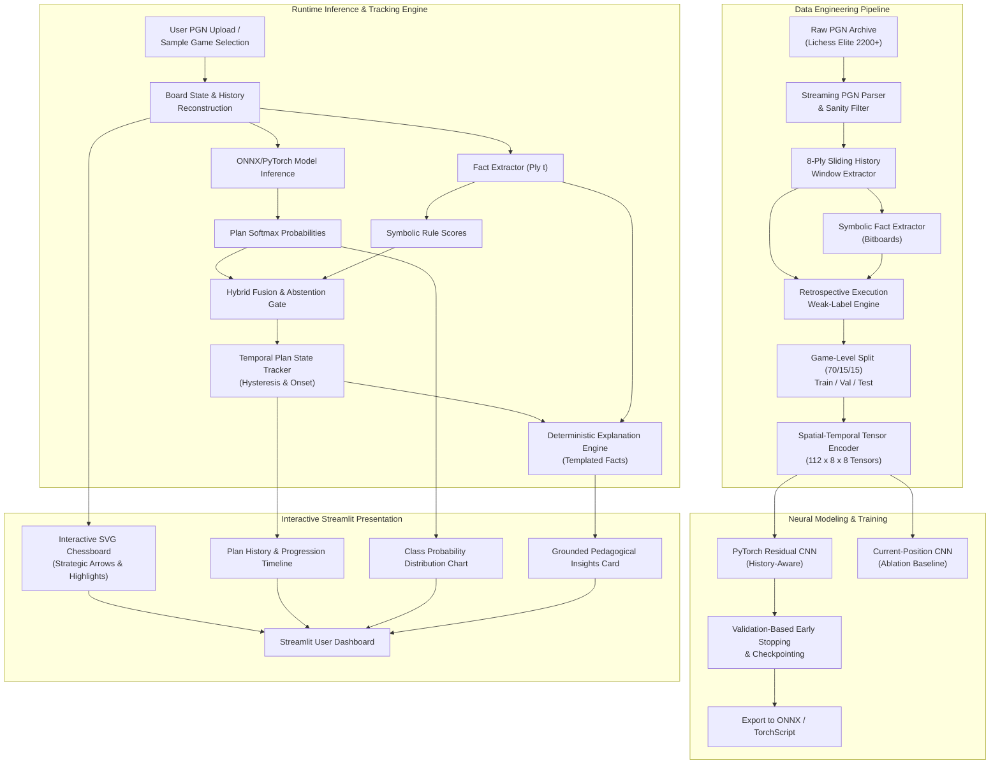

# MindCheck: System Architecture & Pipeline Design

This document details the complete end-to-end technical architecture, tensor representation, neural network specifications, temporal state machine, and data flow for **MindCheck**.

---

## 1. End-to-End System Pipeline



---

## 2. Spatial-Temporal Chess Tensor Representation

### 2.1 Single Board State Representation ($14 \times 8 \times 8$)
For any given half-move (ply), the board is encoded into 14 binary planes of dimension $8 \times 8$:
- **Planes 0–5 (Friendly Pieces)**: Pawns, Knights, Bishops, Rooks, Queens, King (1 if piece is present, 0 otherwise).
- **Planes 6–11 (Opponent Pieces)**: Pawns, Knights, Bishops, Rooks, Queens, King.
- **Plane 12 (Castling Rights)**: Replicated scalar plane encoding friendly kingside/queenside and opponent kingside/queenside castling availability.
- **Plane 13 (En-Passant & Side to Move)**: Target square for en-passant capture (if available) and side to move.

### 2.2 History Stacking ($112 \times 8 \times 8$)
To represent trajectory and strategic momentum, the neural network ingests a sliding window of the **last 8 consecutive half-moves** (plies $t-7, t-6, \dots, t-1, t$):
$$\text{Tensor Shape} = (T \times C_{\text{board}}, H, W) = (8 \times 14, 8, 8) = (112, 8, 8)$$

### 2.3 Board Orientation Normalization
To enforce spatial rotational invariance and prevent the network from having to learn duplicate white/black patterns:
- If the attacking player (side to move at ply $t$) is **White**, the board is oriented standardly (Rank 1 at bottom, Rank 8 at top).
- If the attacking player is **Black**, the board is flipped vertically and horizontally, and piece colors are inverted (Black pieces mapped to Friendly planes 0–5, White pieces to Opponent planes 6–11).
- **Result**: The attacking side is *always* advancing toward Rank 8 from the perspective of the neural network.

### 2.4 History Padding & Masking
When analyzing positions in the opening (plies $0 \le t < 7$), history slots for $t < 0$ are zero-padded, and a 1D validity mask $M \in \{0, 1\}^8$ is passed alongside the tensor to denote valid vs padded board states.

---

## 3. Deep Residual CNN Architecture

The neural network utilizes a compact, highly expressive ResNet architecture optimized for chess spatial geometries:

```
Input Tensor: [Batch, 112, 8, 8]
        │
        ▼
Conv2D (112 -> 64, kernel 3x3, stride 1, padding 1) + BatchNorm2D + GELU
        │
        ▼
Residual Block 1:
   ├── Conv2D (64 -> 64, kernel 3x3, padding 1) + BatchNorm2D + GELU
   └── Conv2D (64 -> 64, kernel 3x3, padding 1) + BatchNorm2D
   └── Skip Connection (+) + GELU
        │
        ▼
Residual Block 2:
   ├── Conv2D (64 -> 64, kernel 3x3, padding 1) + BatchNorm2D + GELU
   └── Conv2D (64 -> 64, kernel 3x3, padding 1) + BatchNorm2D
   └── Skip Connection (+) + GELU
        │
        ▼
Residual Block 3:
   ├── Conv2D (64 -> 64, kernel 3x3, padding 1) + BatchNorm2D + GELU
   └── Conv2D (64 -> 64, kernel 3x3, padding 1) + BatchNorm2D
   └── Skip Connection (+) + GELU
        │
        ▼
Residual Block 4:
   ├── Conv2D (64 -> 64, kernel 3x3, padding 1) + BatchNorm2D + GELU
   └── Conv2D (64 -> 64, kernel 3x3, padding 1) + BatchNorm2D
   └── Skip Connection (+) + GELU
        │
        ▼
AdaptiveAvgPool2D(1, 1) -> Shape: [Batch, 64]
        │
        ▼
LayerNorm(64) -> Dropout(p=0.2)
        │
        ▼
Linear (64 -> 6)
        │
        ▼
Logits [Batch, 6] -> Softmax -> Class Probabilities
```

- **Parameter Count**: ~280,000 parameters (extremely lightweight, ensures low-latency execution).
- **Inference Speed**: ~8ms on CPU via ONNX Runtime / TorchScript; < 2ms on CUDA GPU.

---

## 4. Temporal Plan State Machine (Hysteresis & Onset)

Chess plans do not mutate every single turn; a player advancing pawns on the kingside maintains that intention over 4–10 plies. Raw neural network predictions can flicker between plies due to micro-tactical moves (e.g. intermediate checks).

To enforce strategic continuity, MindCheck introduces a **Stateful Hysteresis Tracker**:

```
State Machine Rules:
1. Candidate Plan: At ply t, neural+rule hybrid identifies candidate plan C.
2. Activation Threshold: Candidate C must be predicted with confidence > 0.45 for 
   TWO CONSECUTIVE PLIES (t-1 and t) before the active state switches to C.
3. Retention Hysteresis: An active plan remains the dominant state even if confidence 
   temporarily dips, unless an alternative plan D meets the 2-consecutive-ply threshold.
4. Onset Backtracking: When plan C activates, the tracker backtracks through the 
   recent history window to mark the earliest supporting ply as the Plan Onset.
5. Deactivation: If NO_PLAN or ambiguous tactical states persist for >= 3 plies, 
   the active state decays gracefully to NO_PLAN.
```

---

## 5. Symbolic-Neural Score Fusion

The system blends learned neural representations with deterministic board facts:

$$S_{\text{hybrid}}(c) = \alpha \cdot P_{\text{neural}}(c) + (1 - \alpha) \cdot S_{\text{rule}}(c)$$

- $\alpha \in [0, 1]$: Weight parameter tuned on the validation set (typically $\alpha \approx 0.70$).
- $P_{\text{neural}}(c)$: Softmax probability for plan class $c$.
- $S_{\text{rule}}(c)$: Normalized symbolic evidence score computed from bitboard predicates.
- **Abstention Gate**: If $\max_c S_{\text{hybrid}}(c) < \theta_{\text{abstain}}$ (e.g., $0.40$) or if top-2 margin $< 0.10$, MindCheck flags the position as *Strategically Ambiguous / Uncommitted* (`NO_PLAN`).
